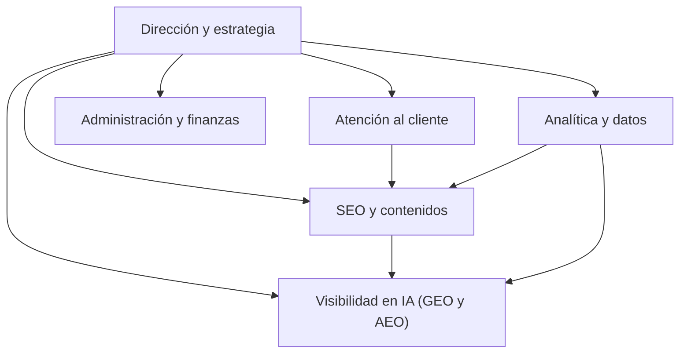

# 01 · Análisis y documentación inicial (RA1)

> **Plantilla.** Se entrega como **H1 el 26-nov-2026**. Cada apartado indica el criterio de evaluación (CE) que evidencia y qué se espera. Borra las notas en cursiva al rellenar.

## 1. Sector y empresas (CE 1a, 1b)
Sector: el del marketing digital y la visibilidad en buscadores. Agrupa a las agencias de publicidad y SEO, a las consultoras de posicionamiento y a las plataformas que analizan cómo aparece una web en Google y en los motores de IA, además de las empresas que hacen ese trabajo con medios propios.

CNAE 7311 · Actividades de las agencias de publicidad · [CNAE-2025 (INE)](https://www.ine.es/daco/daco42/clasificaciones/cnae25/CNAE_2025.pdf) · 2026-11-19 · sin leer

**Importante** `presencIA` no es una agencia. No gestiona campañas ni ejecuta mejoras: audita una URL, puntúa SEO, GEO y AEO y recomienda qué cambiar. Aplicar las mejoras sería un servicio añadido si el proyecto pasara a una empresa real; en su alcance académico, solo audita, genera el informe y recomienda.

| Empresa | Tamaño | Forma | Ámbito | Servicio | Fuente y fecha | Estado |
|---|---|---|---|---|---|---|
| SE Ranking | No lo dice: su web habla de clientes, no de empleados | SER Acquisition Inc. (pie de página) | Internacional: más de 150 países y web en 11 idiomas | Plataforma SEO: posiciones, palabras clave, auditoría y visibilidad en IA | [seranking.com/es](https://seranking.com/es/) · 2026-11-19 | leído |
| Morningscore | No lo dice: habla de 4.000 clientes, no de empleados | Pendiente: la portada no indica la sociedad | Internacional: clientes en 40 países y web en español e inglés | SEO y GEO para pequeñas empresas: palabras clave, SEO Score, GEO Score sobre 100 prompts, visibilidad en ChatGPT y AI Overviews, salud del sitio y plugins para WordPress y Shopify | [morningscore.io/es](https://morningscore.io/es/) · 2026-11-19 | leído |
| Keyword.com | No lo dice | Pendiente: la portada no indica la sociedad | Internacional: web en varios idiomas, sin lista de países | Rastreador de posiciones y visibilidad en IA: Google, SERP locales, AI Overviews, AI Mode, ChatGPT, Perplexity y Gemini; API, MCP e informes en marca blanca | [keyword.com/es](https://keyword.com/es/) · 2026-11-19 | leído |
| Semrush | No lo dice en la portada | Pendiente: la portada no indica la sociedad | Internacional: web en varios idiomas | Plataforma SEO y de visibilidad en IA (Semrush One): palabras clave, competidores, auditoría técnica, tráfico, contenidos, local, RR. PP. para IA y API | [es.semrush.com](https://es.semrush.com/) · 2026-11-19 | leído |
| Serpstat | No lo dice | Pendiente: la portada no indica la sociedad | Internacional: 230 países, según su web | Investigación de palabras clave, análisis de competidores, seguimiento de posiciones, auditoría del sitio y API en Google y Bing | [serpstat.com/es](https://serpstat.com/es/) · 2026-11-19 | leído |
| Lighthouse | No aplica: no es una empresa | No aplica: proyecto de código abierto de Google, con licencia Apache-2.0 | No aplica: se usa desde DevTools de Chrome o PageSpeed Insights | Auditoría técnica de rendimiento, accesibilidad, SEO y buenas prácticas; no cubre contenido ni visibilidad en IA | [developer.chrome.com/docs/lighthouse/overview](https://developer.chrome.com/docs/lighthouse/overview) y [repositorio](https://github.com/GoogleChrome/lighthouse) · 2026-11-19 | leído |

Las seis se reparten en tres grupos. **Plataformas todo en uno**: SE Ranking, Semrush y Serpstat. Venden lo mismo con más o menos catálogo, se dirigen a agencias y equipos SEO y cobran suscripción. **Herramientas de posicionamiento para pymes**: Morningscore y Keyword.com. Precio bajo, foco en el seguimiento diario y en que la empresa pueda hacerlo sola. **Auditoría técnica abierta**: Lighthouse. No compite con las demás, es gratis y no vende nada: mide rendimiento y SEO técnico.

**Empresa tipo: la agencia de marketing digital de tamaño pequeño.** Es la que mejor resume el sector porque es la que compra las herramientas de los otros dos grupos. No es ninguna empresa real: describe a la agencia mediana del sector, y el organigrama es **deducción mía** a partir de los servicios que estas agencias publican en sus webs, no un organigrama que ellas publiquen.

Funciones, una frase por departamento:

- **Dirección y estrategia:** fija el plan de cada cliente, pone precio y responde de los resultados.
- **SEO y contenidos:** investiga palabras clave y redacta y corrige las páginas.
- **Visibilidad en IA (GEO y AEO):** mide cómo aparece la marca en ChatGPT, Perplexity y los resúmenes de Google y prepara el contenido que quieren citar.
- **Analítica y datos:** monta el seguimiento de posiciones y tráfico y saca los informes.
- **Atención al cliente:** recoge la petición, explica el informe y avisa de las subidas y bajadas.
- **Administración y finanzas:** factura, cobra y controla lo que cuestan las herramientas.

## 2. Necesidades y oportunidades (CE 1c, 1d)

*Lista **priorizada** de las necesidades más demandadas, con el criterio de priorización y la fuente. Valora las oportunidades de negocio con **al menos un dato cuantitativo** y su fuente.*

**Criterio de priorización:** se ordenan por el número de **fuentes externas** que mencionan la necesidad; las soluciones del apartado 2 de `01b-sota.md` se listan aparte porque muestran oferta, no demanda. En caso de empate manda lo que `presencIA` puede resolver dentro de su alcance (auditoría técnica, informe y recomendaciones).

| # | Necesidad | Soluciones que la ofrecen | Fuentes externas | Nº ext. | Dato cuantitativo | Oportunidad para presencIA |
|---|---|---|---|---|---|---|
| 1 | Saber si aparece en las respuestas de IA | 4: SE Ranking, Morningscore, Keyword.com, Semrush | [ONTSI](https://www.ontsi.es/es/publicaciones/indicadores-de-uso-de-inteligencia-artificial-en-espana-2025) · 2026 · 2026-11-19 · leído [Pew](https://www.pewresearch.org/short-reads/2025/07/22/google-users-are-less-likely-to-click-on-links-when-an-ai-summary-appears-in-the-results/) · 2025-07-22 · leído [BrightLocal SMB 2026](https://www.brightlocal.com/research/smb-marketing-report/) · leído [Google AI features](https://developers.google.com/search/docs/appearance/ai-features) · sin fecha · leído | 4 | 55,2 % de usuarios de internet en España usa IA generativa (ONTSI); clic del 8 % con resumen de IA frente al 15 % sin él (Pew, 2025) | La IA ya resta clics; hay demanda de saber si la empresa aparece |
| 2 | Saber en qué posición aparece en Google | 5: SE Ranking, Morningscore, Keyword.com, Semrush, Serpstat | [BrightLocal Consumer](https://www.brightlocal.com/research/consumer-search-behavior) · 2025-04-29 · leído [BrightLocal SMB 2026](https://www.brightlocal.com/research/smb-marketing-report/) · leído | 2 (misma editorial) | 71 % de consumidores usa Google; solo 22 % de pymes cree que le trae clientes (BrightLocal SMB 2026) | Google sigue siendo el canal principal; la brecha entre confianza y realidad es el hueco |
| 3 | Aparecer en búsquedas locales y Maps | 2: Keyword.com, Semrush | [BrightLocal Consumer](https://www.brightlocal.com/research/consumer-search-behavior) · 2025-04-29 · leído [BrightLocal SMB 2026](https://www.brightlocal.com/research/smb-marketing-report/) · leído | 2 (misma editorial) | 45 % usa Google para buscar local; 15 % Maps (BrightLocal Consumer, 2025) | Lo local es puerta de entrada, pero queda fuera del alcance de presencIA: solo se detectaría, no se gestiona la ficha |
| 4 | Hacerlo sin tiempo ni conocimientos | 1: Morningscore | [BrightLocal SMB 2026](https://www.brightlocal.com/research/smb-marketing-report/) · leído | 1 | 98 % de pymes hace su propio marketing; 28 % lo ve demasiado técnico | No tienen tiempo ni conocimiento: informe claro y una sola URL es el hueco |
| 5 | Detectar fallos técnicos que impiden aparecer | 5: SE Ranking, Morningscore, Semrush, Serpstat, Lighthouse | [Google Search Central, guía SEO básica, «Help Google find your content»](https://developers.google.com/search/docs/fundamentals/seo-starter-guide) · sin fecha de publicación · acceso 2026-11-25 · sin leer | 1 | — | Si la web no se rastrea o no es elegible, no aparece; es el núcleo de presencIA |
| 6 | Tener un informe presentable | 2: SE Ranking, Keyword.com | [Google Search Central, guía SEO básica, «Next steps» (Search Console)](https://developers.google.com/search/docs/fundamentals/seo-starter-guide) · sin fecha de publicación · acceso 2026-11-25 · sin leer | 1 | — | El informe es lo que el cliente entiende y lo que justifica pagar |
| 7 | Saber qué palabras clave busca su cliente | 4: SE Ranking, Morningscore, Semrush, Serpstat | [Google Search Central, guía SEO básica, «Expect your readers' search terms»](https://developers.google.com/search/docs/fundamentals/seo-starter-guide) · sin fecha de publicación · acceso 2026-11-25 · sin leer | 1 | — | Sin saber qué busca el cliente, se optimiza a ciegas; está en el alcance |
| 8 | Vigilar a la competencia | 3: SE Ranking, Semrush, Serpstat | **Pendiente:** no he encontrado fuente externa que pida vigilar a la competencia. Las páginas que lo mencionan son plataformas que venden esa función y cuentan como oferta, no como demanda | 0 | — | Da prioridades, pero queda fuera del alcance académico de presencIA |

Las filas 5, 6 y 7 comparten una sola fuente de Google, citada por la sección que menciona cada necesidad; cuenta como una fuente en cada fila, no como tres.

## 3. Tipo de proyecto elegido (CE 1e)

*Qué proyecto das como respuesta y por qué, frente a otras alternativas.*

**Por qué la aplicación web.** Es la única opción que recoge las seis funcionalidades imprescindibles de `00-documentoInicio.md`: auditoría con puntuación, informe, explorador de keywords, seguimiento de posiciones, login y formulario con email. Además, aplica las decisiones ya tomadas en `01b-sota.md` §4: Java + Spring Boot, PostgreSQL, HTML + CSS + JavaScript, Spring Security con JWT y Docker en un VPS.

**Por qué no las otras dos.** La extensión es más barata y rápida, pero se queda sin zona privada, sin login, sin panel de seguimiento y sin descarga de informes. El script/CLI sirve para generar informes, pero deja fuera el formulario público, el panel en tiempo real y el despliegue web. La aplicación web no es la opción más barata ni la más rápida; es la que cubre el alcance previsto sin dejar funciones imprescindibles fuera.

## 4. Requisitos y restricciones (CE 1f)

| ID | Requisito | Tipo (funcional / no funcional / restricción) | Cómo se verifica |
|---|---|---|---|
| RF-01 | Auditar una URL y mostrar puntuación SEO, GEO y AEO | funcional | Introducir una URL de ejemplo y comprobar que aparecen las tres puntuaciones y las incidencias detectadas |
| RF-02 | Generar el informe en modo privado, público o por URL | funcional | Al terminar una auditoría, abrir los tres modos y comprobar que el informe se ve en cada uno |
| RF-03 | Explorar keywords con sugerencias, intención y dificultad | funcional | Introducir una keyword de prueba y comprobar que se muestran los tres datos |
| RF-04 | Mostrar el seguimiento de posiciones de una marca | funcional | Registrar una marca con datos de ejemplo y comprobar que su posición aparece en el panel |
| RF-05 | Permitir login en la zona privada | funcional | Iniciar y cerrar sesión con credenciales de prueba y comprobar el acceso a la zona privada |
| RF-06 | Enviar el formulario de información con email de confirmación | funcional | Rellenar el formulario con datos de ejemplo y comprobar que llega el correo de confirmación |
| RNF-01 | La auditoría de una URL termina y muestra el resultado | no funcional | Introducir una URL de ejemplo y comprobar que aparece el informe; el tiempo exacto queda pendiente |
| RNF-02 | La zona privada pide usuario y contraseña | no funcional | Entrar con un usuario de prueba y comprobar que, sin sesión iniciada, no se ve el panel |
| RNF-03 | La auditoría se pide en una sola pantalla y el informe usa lenguaje claro | no funcional | Comprobar que solo hay un campo principal de URL y que una persona sin conocimientos de SEO entiende la puntuación y tres recomendaciones |
| RNF-04 | La aplicación se abre desde un navegador en una dirección pública | no funcional | Abrir la dirección en otro navegador o en modo incógnito y comprobar que carga |
| RNF-05 | Los campos tienen etiqueta y se pueden recorrer con el teclado | no funcional | Rellenar el formulario usando solo la tecla Tab; el nivel concreto de accesibilidad queda pendiente |
| REST-01 | Entrega H1 el 26-nov-2026 (`docs/01-analisis.md` y `01b-sota.md`) | restricción | Comprobar que el análisis y el SOTA están cerrados antes de esa fecha |
| REST-02 | Proyecto académico sin empresa real (`00-documentoInicio.md` §9). El coste del alojamiento sigue pendiente (`01b-sota.md` §4); no se pone una cifra inventada | restricción | Revisar que no aparece ningún importe sin fuente |
| REST-03 | Tecnologías del ciclo: Java, HTML, CSS, JavaScript y SQL (`00-documentoInicio.md` §7); base de datos SQL elegida: PostgreSQL (`01b-sota.md` §4). No añadir otras sin decidirlo antes | restricción | Revisar código y base de datos; comprobar que no aparece una tecnología nueva sin decisión |
| REST-04 | Sin datos personales reales (`00-documentoInicio.md` §9). Repositorio público: ni claves ni contraseñas (`AGENTS.md`) | restricción | Formularios y base de datos con datos de ejemplo; revisar que no hay `.env` ni claves (el `.gitignore` ya excluye `.env`) |
| REST-05 | Alcance: `presencIA` audita, puntúa y recomienda; no ejecuta mejoras (`01-analisis.md` §1, `01b-sota.md` §5) | restricción | Comprobar que el informe propone cambios y que la aplicación no los aplica |
| REST-06 | No se promete conexión en tiempo real con motores de IA: la duda está en `00-documentoInicio.md` §10 y sigue pendiente | restricción | Revisar que el documento no afirma una conexión que no está comprobada |

### Matriz de trazabilidad

| Objetivo | Requisito | Caso de uso | Pantalla o endpoint | Prueba o indicador |
|---|---|---|---|---|
| OBJ-01 Auditar una URL y devolver las tres puntuaciones con sus incidencias en una sola pantalla; se cumple si, al introducir una URL de ejemplo, aparecen los tres números y el listado (sí/no) | RF-01 | pendiente | pendiente | pendiente |
| OBJ-01 Auditar una URL y devolver las tres puntuaciones con sus incidencias en una sola pantalla; se cumple si, al introducir una URL de ejemplo, aparecen los tres números y el listado (sí/no) | RNF-01 | pendiente | pendiente | pendiente |
| OBJ-01 Auditar una URL y devolver las tres puntuaciones con sus incidencias en una sola pantalla; se cumple si, al introducir una URL de ejemplo, aparecen los tres números y el listado (sí/no) | RNF-03 | pendiente | pendiente | pendiente |
| OBJ-01 Auditar una URL y devolver las tres puntuaciones con sus incidencias en una sola pantalla; se cumple si, al introducir una URL de ejemplo, aparecen los tres números y el listado (sí/no) | RNF-04 | pendiente | pendiente | pendiente |
| OBJ-02 Mostrar y compartir el informe en los tres modos previstos; se cumple si se abren los tres modos y el informe se ve en cada uno (sí/no) | RF-02 | pendiente | pendiente | pendiente |
| OBJ-03 Explorar keywords y seguir la posición de una marca; se cumple si, al introducir una keyword y registrar una marca de prueba, se ven los tres datos y la posición (sí/no) | RF-03 | pendiente | pendiente | pendiente |
| OBJ-03 Explorar keywords y seguir la posición de una marca; se cumple si, al introducir una keyword y registrar una marca de prueba, se ven los tres datos y la posición (sí/no) | RF-04 | pendiente | pendiente | pendiente |
| OBJ-04 Dar acceso privado, recibir solicitudes de información y permitir el uso con teclado; se cumple si se inicia sesión, llega el correo de confirmación y se recorre el formulario solo con Tab (tres pruebas sí/no) | RF-05 | pendiente | pendiente | pendiente |
| OBJ-04 Dar acceso privado, recibir solicitudes de información y permitir el uso con teclado; se cumple si se inicia sesión, llega el correo de confirmación y se recorre el formulario solo con Tab (tres pruebas sí/no) | RF-06 | pendiente | pendiente | pendiente |
| OBJ-04 Dar acceso privado, recibir solicitudes de información y permitir el uso con teclado; se cumple si se inicia sesión, llega el correo de confirmación y se recorre el formulario solo con Tab (tres pruebas sí/no) | RNF-02 | pendiente | pendiente | pendiente |
| OBJ-04 Dar acceso privado, recibir solicitudes de información y permitir el uso con teclado; se cumple si se inicia sesión, llega el correo de confirmación y se recorre el formulario solo con Tab (tres pruebas sí/no) | RNF-05 | pendiente | pendiente | pendiente |

## 5. Obligaciones fiscales, laborales y de prevención (CE 1g)

**Situación de `presencIA`:** proyecto académico de DAW, sin empresa real ni datos personales reales (`00-documentoInicio.md` §9), sin ingresos, sin personas contratadas y sin centro de trabajo. La tabla separa lo que obliga hoy —nada— de lo que obligaría si el proyecto pasara a ser un negocio real.

| Obligación | Por qué le toca | Norma (con enlace) | Estado |
|---|---|---|---|
| Alta en el IAE | No le toca hoy: no hay actividad económica. Si `presencIA` fuera un negocio, el mero ejercicio de una actividad empresarial ya sería hecho imponible, aunque no hubiera local | RDL 2/2004, arts. 78 y 79 — [BOE](https://www.boe.es/buscar/act.php?id=BOE-A-2004-4214) | leído (2026-11-23) |
| IVA | No le toca hoy: no hay prestaciones a cambio de dinero. Si hubiera clientes y facturas, sí | Ley 37/1992, arts. 1 y 4 — [BOE](https://www.boe.es/buscar/act.php?id=BOE-A-1992-28740) | leído (2026-11-23) |
| Contrato de trabajo | No le toca hoy: no hay personas contratadas. Si las hubiera, la relación retribuida y bajo dirección de otra persona entra en el Estatuto | RDL 2/2015, arts. 1 y 8 — [BOE](https://www.boe.es/buscar/act.php?id=BOE-A-2015-11430) | leído (2026-11-23) |
| Alta y cotización a la Seguridad Social | No le toca hoy: sin trabajadores no hay alta ni cotización. Con plantilla, el alta se pide antes de empezar, hasta 60 días de antelación, y la baja en 3 días naturales | RDL 8/2015, arts. 139 y 142 — [BOE](https://www.boe.es/buscar/act.php?id=BOE-A-2015-11724) y [Punto de Acceso General](https://administracion.gob.es/tu-espacio-europeo/derechos-obligaciones/empresas/empleados/seguridad-social/alta-empleados) | leído (2026-11-23) |
| Prevención de riesgos laborales | No le toca hoy: no hay trabajadores ni puestos de trabajo. Si se contratara, habría que evaluar el puesto antes de empezar | Ley 31/1995, arts. 2 y 16 — [BOE](https://www.boe.es/buscar/act.php?id=BOE-A-1995-24292) | leído (2026-11-23) |
| Protección de datos | No le toca con datos reales: el proyecto usa datos de ejemplo. Si pasara a producción con registro de usuarios, el email sería dato personal y haría falta base jurídica | LO 3/2018, arts. 1, 2 y 5 — [BOE](https://www.boe.es/buscar/act.php?id=BOE-A-2018-16673) | leído (2026-11-23) |

### Lo que no pude comprobar

- Las fechas de actualización del RDL 2/2004, la Ley 37/1992 y el RDL 8/2015: no las he verificado. Solo comprobé las del Estatuto de los Trabajadores (2026-11-18), la Ley de Prevención (2026-04-09) y la LOPDGDD (2025-12-27).
- El RDL 84/1996 y la Orden ESS/484/2013 aparecen citados en la página del Punto de Acceso General, pero no los he leído: quedan `sin leer` y no se usan en la tabla.
- El PDF del INSST sobre evaluación de riesgos figuraba como `leído` en la versión anterior de este apartado. Aquí no se usa, porque una guía no es una norma: queda **pendiente** de que se confirme si se leyó. Mientras no se confirme, la tabla se sostiene solo con el art. 16 de la Ley 31/1995.

## 6. Ayudas y subvenciones (CE 1h)

**Situación:** las ayudas se plantean para la empresa que se constituiría si `presencIA` siguiera, no para el proyecto académico. Hoy no se puede solicitar ninguna porque no existe la sociedad ni la actividad económica, y el proyecto ocupa a una sola persona. Ninguna se ha pedido.

| Ayuda (convocatoria) | Quién puede pedirla | Qué cubre y qué excluye | Cuánto | Plazo | Cómo se solicita | Estado |
|---|---|---|---|---|---|---|
| Préstamo participativo «Startups y pymes» — [enisa.es](https://www.enisa.es/servicios/financiacion/startups-y-pymes/) | Pymes y startups con proyecto empresarial innovador. Requisitos detallados: **pendiente** | Financia el desarrollo del negocio y sus planes de futuro. **No es subvención: se devuelve.** Qué excluye: **pendiente** | De 25.000 a 1.500.000 €, sin garantías; hasta 7 años con carencia de capital de hasta 2 | Permanente: sin convocatoria ni fecha de cierre | **pendiente**: la web los guarda en los desplegables «Requisitos» y «Materiales descargables» | Abierta |
| Préstamo participativo «Emprendedoras Digitales» — [enisa.es](https://www.enisa.es/servicios/financiacion/emprendedoras-digitales/) | Pyme con soluciones tecnológicas en la que las mujeres ocupan posiciones relevantes del órgano de administración o del equipo directivo | Préstamo participativo sin entrar en la gestión ni en la propiedad. Qué excluye: **pendiente** | De 25.000 a 1.500.000 €, sin garantías; hasta 7 años con carencia de hasta 2 | Permanente | **pendiente** | Abierta |
| Bono Kit Digital — [red.es](https://www.red.es/es/actualidad/noticias/kit-digital-cierra-las-dos-ultimas-convocatorias-que-quedaban-abiertas-tras-mas) | Pymes, microempresas y autónomos, por segmentos de plantilla | Bono para soluciones digitales. Qué excluye: **pendiente** | **pendiente** | Cerrado el 2025-10-31; sin convocatoria en 2026 | **pendiente** | Cerrada |
| Bono Kit Consulting — [acelerapyme.gob.es](https://www.acelerapyme.gob.es/kit-consulting) | Pymes de 10 a menos de 250 empleados. `presencIA` no llega al mínimo de plantilla | Bono de asesoramiento digital para diseñar la hoja de ruta. Qué excluye: **pendiente** | 12.000 € de 10 a 49 empleados; 18.000 € de 50 a 99; 24.000 € de 100 a 249 | Cerrada | Sede electrónica de Red.es | Cerrada |
| NEOTEC — [ciencia.gob.es](https://www.ciencia.gob.es/Convocatorias/2026/NEOTEC2026.html) | Empresas de base tecnológica. **Excluye** los modelos basados primordialmente en servicios a terceros sin tecnología propia | Nuevos proyectos empresariales de empresas innovadoras | **pendiente** por proyecto; el presupuesto de la convocatoria es de 20.383.300 € | Del 2026-04-14 al 2026-05-14 | Por la ficha del CDTI, enlace «Acceso a la solicitud» | Cerrada |
| Línea I · Aceleración de Proyectos — [bases (PDF)](https://drupal.gijon.es/sites/default/files/2026-03/1.%20Bases%20Acel.%2C%20IA%20y%20Crecim.%202026%20V5%20%28definitivas%29.pdf) | Persona física empadronada en Gijón y sin actividad previa en el mismo epígrafe del IAE, o autónomo dado de alta después del 2025-09-20. **Excluye** la continuidad de un negocio existente, no generar empleo nuevo y haber sido beneficiaria en los tres ejercicios anteriores | Dos fases: diseño del producto mínimo viable y validación de su viabilidad | Máximo 6.000 €, en dos fases de 3.000 | 8 al 27 de abril y 1 al 20 de septiembre de 2026 | Sede electrónica del Ayuntamiento; bases en el BOPA del 2026-04-07 | Cerrada |
| Programa de Ayuda a la Transformación Digital 2026 — [idepa.es (PDF)](https://www.idepa.es/documents/20147/913921/1.10.Convocatoria_ATD_2026.pdf/9e2a6197-2991-39ff-9658-47004603ac67) | **pendiente** | **pendiente** | **pendiente** | **pendiente** | **pendiente** | No comprobada (`sin leer`) |

**Conclusión:** la única ayuda abierta hoy es el préstamo de ENISA, y tiene dos matices que conviene no esconder: **no es una subvención** —se devuelve, con intereses ligados a los resultados— y exige una sociedad ya constituida. Las subvenciones a fondo perdido que encajarían por tipo de proyecto —Kit Digital, Kit Consulting y NEOTEC— están cerradas en 2026, y la única local que admite a una persona física sin empresa, la Línea I de Gijón, exige estar empadronada en el municipio y volverá a convocarse, como pronto, en 2027.

**Aviso:** varias webs comerciales anuncian «Kit Digital 2026» o «Kit Consulting 2026» con plazos abiertos. Ninguna de esas convocatorias aparece en las fuentes oficiales consultadas.

### Lo que no pude comprobar

- Los requisitos detallados de ENISA y cómo se solicita: su web los esconde en desplegables que no se despliegan.
- El importe del bono del Kit Digital y su vía de solicitud: la página que he leído solo anuncia el cierre.
- La ayuda por proyecto de NEOTEC: la ficha oficial publica el presupuesto total, no la cuantía individual.
- Toda la convocatoria de SEKUENS/IDEPA: el PDF no se puede abrir con las herramientas de esta sesión.

### Fuentes consultadas

Fecha de acceso: 2026-11-23.

| Fuente | Enlace | Estado |
|---|---|---|
| ENISA, «Financiación para startups y pymes»: importes y condiciones | [enisa.es](https://www.enisa.es/servicios/financiacion/startups-y-pymes/) | leído |
| ENISA, «Emprendedoras Digitales»: destinatarias e importes | [enisa.es](https://www.enisa.es/servicios/financiacion/emprendedoras-digitales/) | leído |
| Red.es, «Kit Digital cierra las dos últimas convocatorias que quedaban abiertas» (2025-10-31) | [red.es](https://www.red.es/es/actualidad/noticias/kit-digital-cierra-las-dos-ultimas-convocatorias-que-quedaban-abiertas-tras-mas) | leído |
| Acelera pyme, «Kit Consulting»: importes por tramo de plantilla y aviso de convocatoria finalizada | [acelerapyme.gob.es](https://www.acelerapyme.gob.es/kit-consulting) | leído |
| Ministerio de Ciencia, Innovación y Universidades, «Programa NEOTEC 2026»: estado, plazos, presupuesto y criterio de empresa de base tecnológica | [ciencia.gob.es](https://www.ciencia.gob.es/Convocatorias/2026/NEOTEC2026.html) | leído |
| Ayuntamiento de Gijón, bases de los Incentivos Impulsa 2026 (Línea I): requisitos de personas físicas, autónomos y empresas | [gijon.es (PDF)](https://drupal.gijon.es/sites/default/files/2026-03/1.%20Bases%20Acel.%2C%20IA%20y%20Crecim.%202026%20V5%20%28definitivas%29.pdf) | leído |
| Ayuntamiento de Gijón, «Aprobadas en Junta de Gobierno las convocatorias de las líneas de subvenciones Gijón Impulsa 2026» (2026-03-24) | [gijon.es](https://drupal.gijon.es/es/aprobadas-en-junta-de-gobierno-las-convocatorias-de-las-lineas-de-subvenciones-gijon-impulsa-2026) | leído |
| SEKUENS/IDEPA, convocatoria del Programa de Ayuda a la Transformación Digital 2026 (PDF) | [idepa.es (PDF)](https://www.idepa.es/documents/20147/913921/1.10.Convocatoria_ATD_2026.pdf/9e2a6197-2991-39ff-9658-47004603ac67) | sin leer |

## 7. Guion de trabajo (CE 1i)

Fechas copiadas de la guía del curso el 2026-11-25. Son **provisionales** hasta que se apruebe el calendario del centro. Las fases acaban el mismo día en que empieza la siguiente.

| Fase | Fechas | Tareas principales | Responsable | Hito |
|---|---|---|---|---|
| 1 Análisis | 6-nov a 26-nov-2026 | Cerrar `00-documentoInicio.md`, `01-analisis.md` y `01b-sota.md`; comprobar cada fuente antes de marcarla como leída | Autoría del proyecto | **H1** 26-nov-2026 |
| 2 Diseño | 26-nov a 10-dic-2026 | Bocetos de las tres pantallas principales (auditoría, informe y panel); modelo de datos y lista de endpoints; decidir la autenticación con Spring Security y JWT | Autoría del proyecto | — |
| 3 Planificación | 10-dic-2026 a 21-ene-2027 | Guion de pruebas y casos de uso; reparto de tareas en el tablero; presupuesto del VPS | Autoría del proyecto | **H2** 21-ene-2027 |
| 4 Implementación | 21-ene a 31-mar-2027 | Backend con Spring Boot (auditoría, keywords y posiciones); frontend en HTML, CSS y JavaScript; login de la zona privada | Autoría del proyecto | — |
| 5 Pruebas | 1-abr a 23-abr-2027 | Probar los RF-01 a RF-06; recorrer el formulario solo con el teclado (RNF-05); medir el tiempo de la auditoría (RNF-01) | Autoría del proyecto | — |
| 6 Despliegue | 26-abr a 7-may-2027 | Publicar con Docker en el VPS, con HTTPS y dominio; dejar una copia de seguridad y un procedimiento para restaurarla | Autoría del proyecto | **H3** 7-may-2027 |
| 7 Seguimiento, control y cierre | 11-feb a 18-jun-2027 | Anotar cada semana en `registro-tutoria.md`; revisar riesgos y desviaciones; redactar la memoria final | Autoría del proyecto | — (corre en paralelo a las fases 4, 5 y 6) |

## 8. Glosario

Una cosa, un nombre. Cuando una palabra de esta tabla aparezca en otro documento, se escribe así y no de otra forma. Los sinónimos de la última columna no se usan en ningún sitio, ni en la documentación ni en la interfaz.

| Término | Definición | Sinónimos que NO uso |
|---|---|---|
| Auditoría | El proceso completo: `presencIA` recibe una URL, la analiza y emite una puntuación con recomendaciones. Es el servicio que ofrece el proyecto | «análisis», «revisión», «diagnóstico», «estudio» |
| Informe | El resultado de la auditoría: el documento que la empresa lee o descarga, con la puntuación y las recomendaciones. La auditoría es el proceso; el informe, lo que se entrega | «reporte», «resultado», «output» |
| SEO | Conjunto de prácticas para que una página aparezca en los resultados de los buscadores | «posicionamiento web», «posicionamiento orgánico», «SEO tradicional» |
| GEO | Conjunto de prácticas para que una página sea citada en las respuestas de los asistentes de IA generativa | «SEO para IA», «optimización para IA» |
| AEO | Conjunto de prácticas para que la respuesta directa o el resumen que muestra el buscador recoja el contenido de la página | «SEO de respuestas», «optimización de respuestas» |
| Visibilidad en IA | Nombre que usa el proyecto para GEO y AEO en conjunto. Cuando el texto se refiera solo a uno de los dos, se escribe GEO o AEO, no «visibilidad» | «presencia en IA», «visibilidad generativa» |
| Puntuación | Número con el que el informe resume el estado de una URL | «nota», «score», «valoración» |
| Palabras clave | Los términos por los que una persona busca en un buscador | «keywords» (solo se admite en nombres de código o de campo) |
| SERP | La página de resultados que devuelve un buscador para una búsqueda | «resultados de Google», «página de resultados» |
| Rastreo | Recorrer una web página a página para analizarla. Quien lo hace es el rastreador | «crawling», «spider», «bot» |
| URL | La dirección de una página concreta que se audita | «enlace», «link», «dirección» (enlace se reserva para los hipervínculos de las fuentes) |
| Cliente | La empresa cuya web se audita | «usuario», «cuenta» |
| Usuario | La persona que se registra e inicia sesión en la zona privada | «cliente», «miembro» |
| Freemium | Modelo del proyecto: la primera auditoría de una URL es gratuita —una por URL— y el resto se paga por suscripción | «gratis con límite», «prueba gratuita» |

---

## Criterios de evaluación de este documento (RA1, texto literal)

- **1a)** Se han clasificado las empresas del sector por sus características organizativas y el tipo de producto o servicio que ofrecen.
- **1b)** Se han caracterizado las empresas tipo indicando la estructura organizativa y las funciones de cada departamento.
- **1c)** Se han identificado las necesidades más demandadas a las empresas.
- **1d)** Se han valorado las oportunidades de negocio previsibles en el sector.
- **1e)** Se ha identificado el tipo de proyecto requerido para dar respuesta a las demandas previstas.
- **1f)** Se han determinado las características específicas requeridas al proyecto.
- **1g)** Se han determinado las obligaciones fiscales, laborales y de prevención de riesgos y sus condiciones de aplicación.
- **1h)** Se han identificado posibles ayudas o subvenciones para la incorporación de nuevas tecnologías de producción o de servicio que se proponen.
- **1i)** Se ha elaborado el guión de trabajo que se va a seguir para la elaboración del proyecto.
